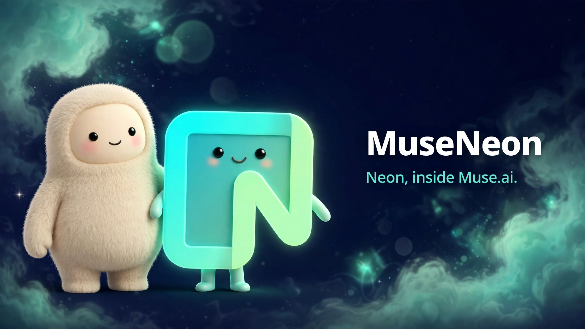
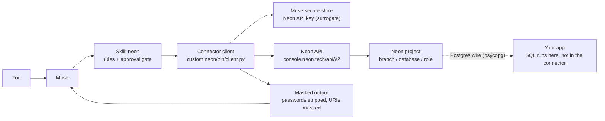

# MuseNeon



**Neon, inside Muse.ai.**

[](https://github.com/reblox01/MuseNeon/releases)
[](https://github.com/reblox01/MuseNeon/actions/workflows/ci.yml)
[](LICENSE)

MuseNeon is a Muse-native connector for Neon, the serverless Postgres
platform. It lets Muse create and manage Neon projects, branches,
databases, and roles, and hand back the connection string a Postgres
client needs, with your approval before anything is created or deleted.

**Status:** v0.1.1 released, verified live. The connector is connected
to a Neon account, `list-projects` works, and the first real project
(`basement-tycoon`) was created through it.

## Install

Say this to Muse:

```
Install MuseNeon v0.1.1 from https://github.com/reblox01/MuseNeon
```

Or install it by hand:

```bash
# Download the release zip from
# https://github.com/reblox01/MuseNeon/releases/latest
# (museneon-v0.1.1.zip), unzip it, then:
./scripts/install.sh
```

That copies the `neon` skill and the `custom.neon` connector into your
Muse workspace. Then connect your Neon API key through Muse's secure
flow (create one at console.neon.tech, developer settings, API keys),
and verify with:

```
list-projects
```

## How it works

You ask Muse. Muse checks the rules, asks your yes when one is needed,
and the connector client does the rest. The client never sees your API
key in plain text: Muse's secure store hands it a surrogate, and the
client applies it as a Bearer token with the sanctioned helper.



The request flow, step by step:

1. You ask for something, for example "create a Neon project called
   my-bot with a database bot_db".
2. The skill checks the approval gate. Reads go ahead. A create or a
   delete stops and asks for your explicit yes for that exact project,
   branch, database, or role.
3. The client calls `POST /projects` on `console.neon.tech/api/v2`
   with your key as `Authorization: Bearer <surrogate>`.
4. Creating a project or a branch is async. Neon answers with an
   `operations` array, and the client polls
   `GET /projects/{id}/operations/{operation_id}` until every
   operation is `finished` (up to 120 seconds). A failure is reported
   with the operation's error text, never hidden.
5. The client strips every secret from the response before printing
   it: passwords are removed, connection URIs are printed with the
   password replaced by `****`, and the host, database, and role are
   printed as separate fields.
6. You get back the result plus the masked connection string, which
   your app uses over the Postgres wire protocol with a normal driver
   (psycopg).

Writes are never retried blindly: Neon says `POST`, `PATCH`, `DELETE`,
and `PUT` are non-idempotent. A `429` waits out the `Retry-After`
header once. A `423 Locked` (another write still running) is not
retried by the client; poll `get-operation` and retry after the first
job finishes.

## Operations

| Operation | What it does |
|---|---|
| `list-projects` | List projects on the account (cursor pagination, limit 1-400). |
| `get-project` | Full record for one project. |
| `create-project` | Create a project (defaults: branch `main`, database `neondb`, role `{database}_owner`). Polls to `finished`. |
| `delete-project` | Delete a project with every branch and database in it. |
| `list-branches` | List branches in one project. |
| `create-branch` | Create a branch (optional parent branch, timestamp, or LSN). Polls to `finished`. |
| `list-databases` | List databases on one branch. |
| `create-database` | Create a database on a branch (name and owner required). |
| `list-roles` | List roles on one branch. |
| `create-role` | Create a role. The password is generated server-side, returned once, and never printed. |
| `get-connection-string` | The Postgres URI for one database as one role, password masked. |
| `get-operation` | Poll target for async creates. |
| `list-regions` | Regions the account can create projects in. |

Full REST details, auth, and async rules: `docs/ARCHITECTURE.md`.

## What v1 deliberately does not do

There is **no `run-sql` operation**. Neon's management API has no
SQL-execution endpoint. SQL runs over the Postgres wire protocol with a
normal Postgres driver (psycopg), using the connection string from
`get-connection-string`, or in the Neon console SQL editor, or through
Neon's official MCP server (`https://mcp.neon.tech/mcp`), which has
`run_sql`. The connector provisions the database; it never touches the
data inside it.

## Secrets

The Neon API returns database passwords: `create-project` and
`create-branch` return connection URIs with passwords, and `create-role`
returns the generated role password once, at creation. The client strips
all of them before anything reaches stdout: passwords are removed,
connection URIs are printed with the password replaced by `****`, and the
host, database, and role are printed as separate fields. The full URI is
copied from the Neon console to the deployment host inside the browser,
never through chat. See `docs/SAFETY.md`.

## Approval gate

Reads need no approval. Every create and every delete needs the user's
explicit yes for that exact action, in chat, every time. Show the exact
project, branch, database, or role name before asking. A yes for one
project never covers another.

## Layout

- `skills/neon/` — the Muse skill (what Muse may do, and the rules).
- `custom-connectors/custom.neon/` — the connector doc and the client.
- `docs/` — architecture, safety, sources, research.
- `scripts/install.sh` — copies the skill and the connector into a workspace.
- `examples/` — redacted example calls.
- `assets/` — logo and banner.

## License

MIT. See `LICENSE`.
